# Lusion: live-site field notes

Research date: October 13, 2026. Purpose: extract spatial, scroll, and interaction patterns for the existing dotted-hyacinth portfolio.

The pass used actual wheel scrolling and visible UI interaction on the launched websites. The studio's case studies were used for attribution and launch links, not as substitutes for client-site exploration. This is a representative sample of four client experiences, the studio homepage, and one self-initiated project; it is not an exhaustive survey of Lusion's portfolio.

## Scope and evidence

| Surface | Website actually operated | Attribution / status |
| --- | --- | --- |
| Lusion | [Homepage](https://lusion.co/) | Studio site; a later scroll handoff reached `/about` |
| Of The Oak | [Home](https://oftheoak.co.uk/), [Meditations](https://oftheoak.co.uk/meditations), [Species](https://oftheoak.co.uk/oak-species) | [Lusion case study](https://lusion.co/projects/of_the_oak/); work for Marshmallow Laser Feast and Kew |
| Synthetic Humans | [Campaign site](https://synthetic-humans.ai/) | [Lusion case study](https://lusion.co/projects/synthetic_human/); work with Fantasy |
| Atlas Motion | [Homepage](https://atlasmotion.com/) | [Lusion case study](https://lusion.co/projects/atlas_motion/); client site |
| Devin | [Working website archive](https://archive-devin-ai.lusion.co/) | [Lusion case study](https://lusion.co/projects/devin_ai/); archived client website, not the current Devin product site |
| Oryzo | [Homepage](https://oryzo.ai/) | [Lusion case study](https://lusion.co/projects/oryzo_ai/); fictional, self-initiated project, not a client commission |

The first two experiences were captured in the in-app browser at 1440 × 900 to inspect their desktop composition. Synthetic Humans crashed that browser. Its live experience was then successfully operated in Chrome, which was also used for Atlas, Devin, Oryzo, and the final homepage handoff check. Chrome captures use its normal 1440 × 697 content area. The temporary in-app viewport override was reset afterward.

The following 35 original screenshots were retained. They are evidence of visible states, not measurements of frame rate, loading speed, source implementation, or accessibility compliance. Images were copied without modifying their pixels. Loading screens, incomplete capture attempts, ambiguous variant feedback, and redundant frames were excluded.

## 1. Lusion homepage

| Step | Action and observation | General health | Evidence |
| --- | --- | --- | --- |
| 1.1 | Loaded the opening arrangement of rounded blue, white, and black objects inside a large frame. Objects also moved while the page was at rest. | Clear object focus; motion visible | [01](screenshots/01-lusion-hero.jpg) |
| 1.2 | Scrolled past the opening into oversized editorial type, supporting copy, and a reel. A curved graphic links the compositions; the reel becomes a large focal frame. | Strong scale hierarchy | [02](screenshots/02-lusion-editorial.jpg), [03](screenshots/03-lusion-reel.jpg) |
| 1.3 | Physically scrolled through the project grid and into the full-screen astronaut / tunnel sequence. Changes in apparent distance and foreground framing made this feel like entering a space. | Spatial transition worked; intense motion | [04](screenshots/04-lusion-tunnel.jpg) |
| 1.4 | Continued to the contact scene and footer entry. Reversed through the preceding sequence and returned forward. | Reversal visibly changed the scene; white text sometimes competed with bright objects | [05](screenshots/05-lusion-contact.jpg), [06](screenshots/06-lusion-footer-entry.jpg) |
| 1.5 | On a later Chrome pass, continued scrolling beyond the homepage; the site navigated into its About page. The particle subject shown there is only an entry observation, not a full About audit. | Handoff worked; automatic route change can surprise | [07](screenshots/07-lusion-next-page.jpg) |

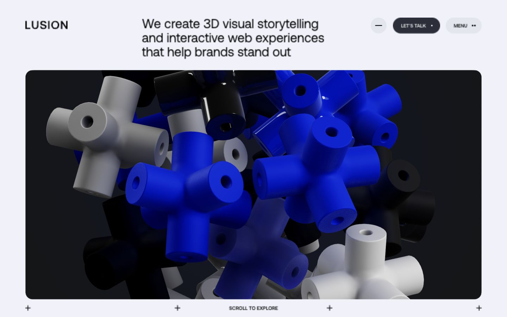

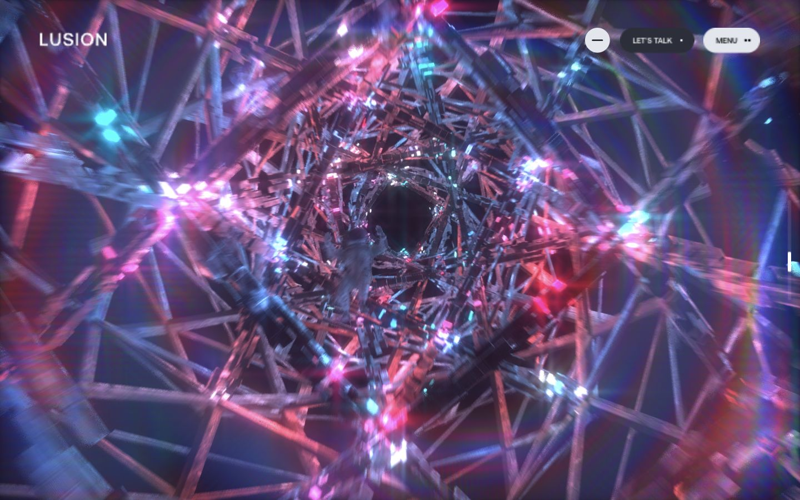

**Transfer:** change the visitor's relationship to the flower—from looking at it to inspecting one of its spaces—while keeping persistent navigation. Let large image moments alternate with quieter content. The observed tunnel is a reference for connected movement, not a reason to add a tunnel to a botanical portfolio.

**Avoid:** permanent maximum spectacle, decorative objects that obscure copy, and an automatic change of route just because the visitor continues scrolling. The opening objects visibly animate at rest; their movement should not all be attributed to scroll.

## 2. Of The Oak

| Step | Action and observation | General health | Evidence |
| --- | --- | --- | --- |
| 2.1 | Opened the forest home scene and attempted scrolling. The main home composition stayed in place; visible links provide entry to the two experiences. | Clear entry choices; home is not a long scroll narrative | [08](screenshots/08-oak-home.jpg) |
| 2.2 | Entered Meditations and attempted scrolling. A pink point field moves around the fixed introduction and playback control. Scrolling did not advance the content in the tested resting state. | Quiet atmosphere; playback-dependent behavior not tested | [09](screenshots/09-oak-meditation.jpg) |
| 2.3 | Entered Oak Species. The tree appears as blue and amber points with bright markers, left-side categories, and a separate text area to the right. | Strong botanical and content hierarchy | [10](screenshots/10-oak-tree.jpg) |
| 2.4 | Scrolled through bird entries. The tree framing and branch relationships changed while the selected species image and text changed alongside it. | Spatial exploration worked; branches sometimes cross the text area | [11](screenshots/11-oak-hawfinch.jpg), [12](screenshots/12-oak-blue-tit.jpg) |
| 2.5 | Selected the Fungi category, then used reverse wheel scrolling within the experience. The category and species information changed while the continuous point structure remained the anchor. | Category selection worked; canvas points were not exhaustively tested | [13](screenshots/13-oak-fungi.jpg) |

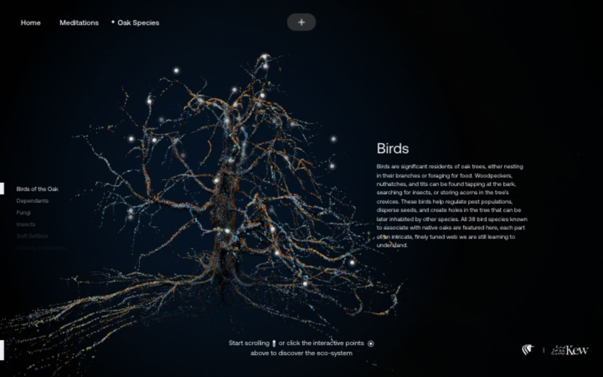

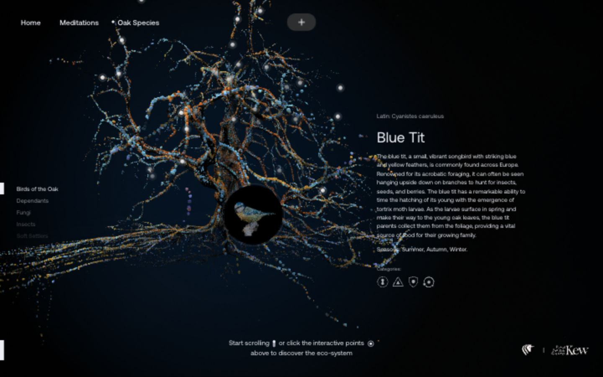

**Transfer:** dots can describe a convincing botanical structure. View changes reveal relationships between parts, and the information can stay in ordinary DOM text alongside the scene. The hyacinth can remain a dotted subject while gaining throats, curled petals, independent rear florets, and meaningful near/far relationships.

**Technical attribution:** Lusion describes a compressed Houdini-to-WebGL tree pipeline, a 3.5 MB download, and instancing in its [case study](https://lusion.co/projects/of_the_oak/). These are the studio's claims, not measurements made during this pass. They support efficient structural representation as a design concern; they do not reveal the exact particle implementation.

**Avoid:** assuming all sections are scroll-driven, copying the tree's density without measuring our flower, or putting important text over a dense branch/petal field. Very dim inactive categories and canvas-only markers need separate keyboard and contrast checks.

## 3. Synthetic Humans

| Step | Action and observation | General health | Evidence |
| --- | --- | --- | --- |
| 3.1 | Loaded the actual campaign in Chrome after the in-app crash. A central trio is surrounded by figures at different apparent depths. | Loaded successfully in Chrome; browser limitation recorded | [14](screenshots/14-synthetic-hero.jpg) |
| 3.2 | Scrolled forward into a face close-up with a luminous internal motif. The camera move and changed representation make the same subject communicate a new idea. | Strong reveal and focal hierarchy | [15](screenshots/15-synthetic-face.jpg) |
| 3.3 | Continued through research scenes and an innovation chapter. Scene arrangement, color, camera distance, and copy change while the peripheral controls persist. | Coherent scene language; some in-between text was blurred or fading | [16](screenshots/16-synthetic-research.jpg), [17](screenshots/17-synthetic-innovation.jpg) |
| 3.4 | Reversed within the narrative, then continued to the concluding product-screen view. Additional forward wheel input left that final composition in place. | Reversal and final state observed; form submission not tested | [18](screenshots/18-synthetic-ending.jpg) |

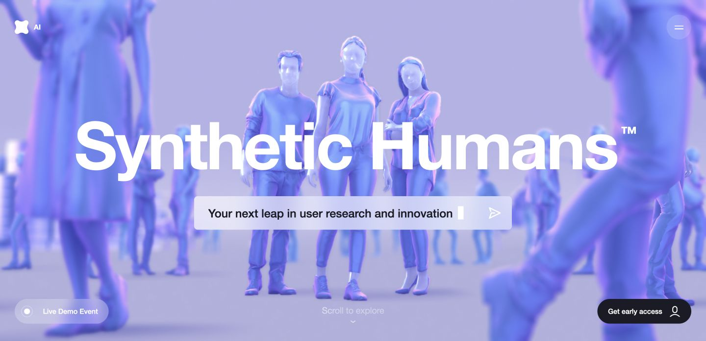

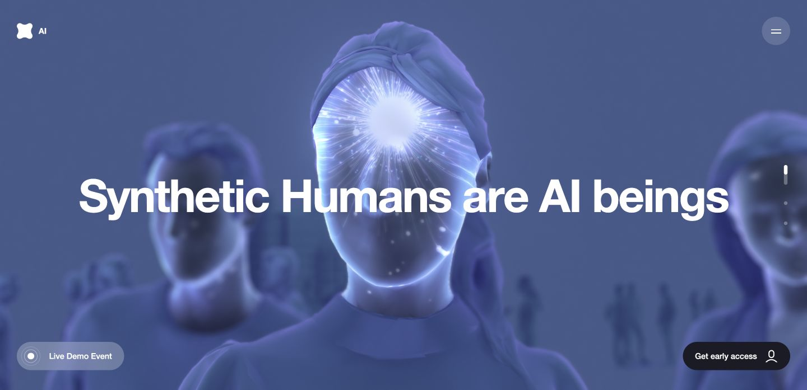

**Transfer:** use recognition, close inspection, and return as distinct compositions. A macro view of one hyacinth floret can reveal that the dots describe a curved throat and folded surfaces. Large changes in scale should occur between reading intervals, not throughout every sentence.

**Avoid:** treating continuous camera travel as permission for continuous unreadability. Motion at rest, changing light, and scroll position can all contribute; the screenshots do not establish the private timeline architecture. The translucent material language is an observation, not a recommendation to replace the flower's dots with glass.

## 4. Atlas Motion

| Step | Action and observation | General health | Evidence |
| --- | --- | --- | --- |
| 4.1 | Loaded the manufacturing imagery and editorial hero; scrolled into the atmospheric mountain setting. A fixed technical grid and navigation carry across scenes. | Consistent framing; useful contrast between imagery and type | [19](screenshots/19-atlas-hero.jpg) |
| 4.2 | Scrolled into a drone composition in the landscape. The subject is isolated at a readable scale with supporting copy nearby. | Clear object and context | [20](screenshots/20-atlas-drone.jpg) |
| 4.3 | Continued into the motor process. The motor's separated outline parts later acquire colored regions and become an assembled object. Reversed toward this sequence to inspect a resting assembled view. | Parts-to-whole relationship worked | [21](screenshots/21-atlas-exploded-motor.jpg), [22](screenshots/22-atlas-assembled-motor.jpg) |
| 4.4 | Continued through the factory / ecosystem content to the footer. | Clear return to practical navigation; small text merits responsive review | [23](screenshots/23-atlas-footer.jpg) |

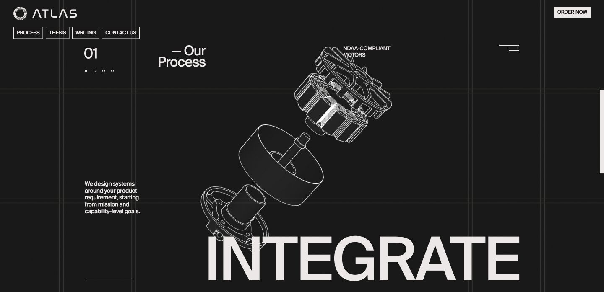

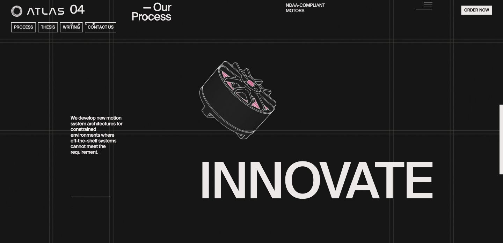

**Transfer:** changing the representation of one subject can be more informative than introducing a new visual in every section. A floret could temporarily open or separate enough to show its anatomy, then return to its exact resting shape. This is a later interaction idea, not part of the minimum true-3D rebuild.

**Avoid:** copying the engineering grid, outline motor style, or industrial palette into a nocturnal flower site. The reusable principle is revealing how parts belong together.

## 5. Devin website archive

| Step | Action and observation | General health | Evidence |
| --- | --- | --- | --- |
| 5.1 | Opened the launch link supplied by Lusion: a working archived site. Stacked interface planes sit beside readable introductory copy. | Archive loaded; current product design not assessed | [24](screenshots/24-devin-hero.jpg) |
| 5.2 | Scrolled through the pinned demonstration. A stable pair of panels switches between planning, shell, editor, and browser content as the explanation and progress indication advance. | Clear correspondence between explanation and demonstration | [25](screenshots/25-devin-planner.jpg), [26](screenshots/26-devin-editor.jpg) |
| 5.3 | Continued into the parallel-work view, where the interface becomes a wider field of panels. | Scale change supports the idea of multiple tasks | [27](screenshots/27-devin-parallel.jpg) |
| 5.4 | Continued into lighter conventional sections, reversed briefly, and scrolled to the footer. | Reading and navigation remain practical outside the opening sequence | [28](screenshots/28-devin-footer.jpg) |

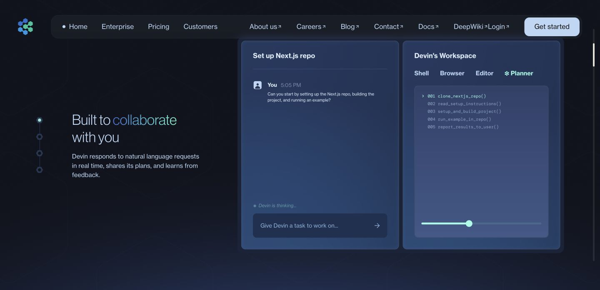

**Transfer:** concentrate immersion where it helps the visitor understand something, then allow quiet reading. Keep project evidence and Spotify controls usable. Our portfolio need not turn every content panel into a moving 3D object.

**Avoid:** duplicating its dense product navigation or making the portfolio's short texts require a long scroll to uncover. This archive is a source of interaction patterns, not evidence of Devin's current public website.

## 6. Oryzo: supplemental studio experiment

| Step | Action and observation | General health | Evidence |
| --- | --- | --- | --- |
| 6.1 | Loaded the desk-based hero and scrolled into an oblique coaster view. The side and underside make its thickness easy to read. | Tangible object staging | [29](screenshots/29-oryzo-hero.jpg), [30](screenshots/30-oryzo-oblique.jpg) |
| 6.2 | Continued through the hand and horizontal wearable gallery into the feature demonstrations, including the thermal-colored cup scene. | Strong recurring subject; long pinned passages can delay information | [31](screenshots/31-oryzo-thermal.jpg) |
| 6.3 | Reached the flip section and clicked its visible control. The coaster rotated from its open face to the opposite side and the button label changed. Existing demo text was left as supplied. | Local action produced visible object feedback | [32](screenshots/32-oryzo-flip-before.jpg), [33](screenshots/33-oryzo-flip-after.jpg) |
| 6.4 | Scrolled into a close-up of the cork and onward through sustainability, reviews, product choices, and the footer. | Material detail and stable ending observed; variant-button result was ambiguous and excluded | [34](screenshots/34-oryzo-macro.jpg), [35](screenshots/35-oryzo-footer.jpg) |

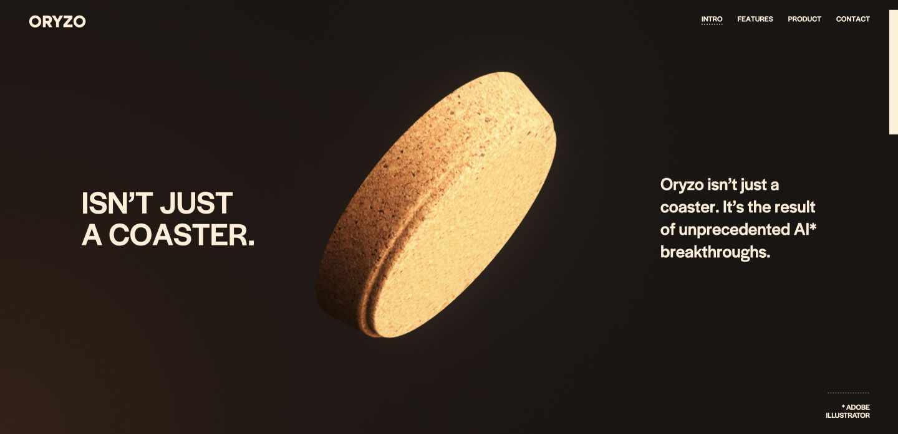

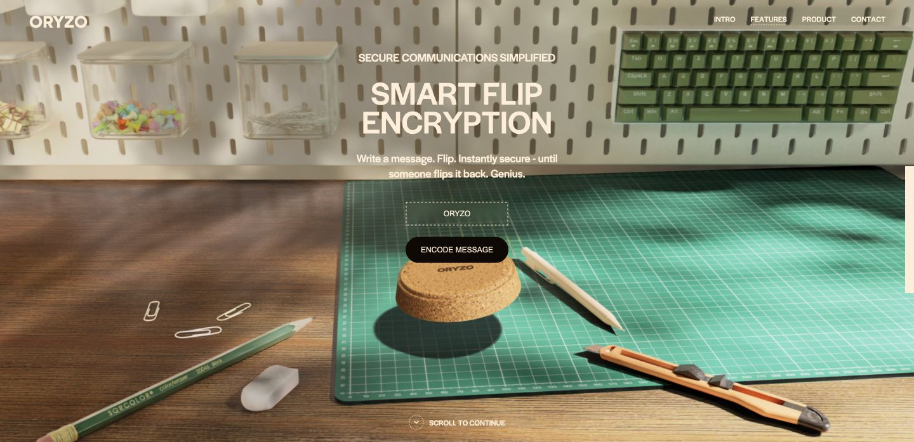

**Transfer:** make an interaction visibly affect the subject itself. The flower's bloom pulse should open, bend, or brighten its local geometry coherently, and a macro view should reveal material structure. A nearby control should explain the action before it happens.

**Avoid:** copying the satire, marketing claims, long galleries, or numerous effects. Oryzo is identified by its own site and Lusion's case study as a fictional studio experiment, not a purchasable product or client website.

## Actionable synthesis for the hyacinth

1. **Preserve dots; replace the supporting anatomy.** Of The Oak gives the strongest visual reference. Reconstruct the flower's surfaces and spatial arrangement, then sample them into dots.
2. **Prove depth through meaningful views.** An oblique angle should reveal petal curl and throat length; a rear view should reveal rear florets. A random Z offset is not enough.
3. **Choreograph three useful states.** Recognition of the whole flower, inspection of one floret, and return to a readable wide composition. Add more only when content earns them.
4. **Keep a stable reference frame.** Navigation and text resting positions should remain predictable while the camera moves through the flower.
5. **Connect action to the object.** Start with a restrained bloom response along local petal directions. Do not add constant cursor-driven rotation to the current composition.
6. **Let calm sections do their work.** Project evidence, personal writing, and songs should stay usable. A visual scene can support the content without animating every element.
7. **Treat performance as part of the design.** Dense points, large halos, and full-screen effects need measurement. The relevant success criterion is clear, responsive structure on the target devices.

These are proposed transfers from the visible experience. They are not claims that the reference sites use the implementation proposed for this portfolio.

## Evidence limits

- Desktop browser observation only; no mobile, touch, screen-reader, full keyboard, zoom, or reduced-motion audit was performed on the references.
- The in-app crash is a limitation of this pass, not proof that Synthetic Humans is generally broken. Its experience was operated successfully in Chrome.
- Meditations playback and audio were not tested. Forms and external calls to action were not submitted.
- Canvas markers, hover effects, and product variants were not exhaustively exercised. Only visibly verified results are used as interaction evidence.
- The homepage footer screenshot records its entry rather than every footer element. The later automatic navigation into About was separately verified from the browser URL and page state.
- Screenshots record compositions and visible changes. No exact source-site camera paths, animation durations, scroll percentages, rendering techniques, or performance results were measured.
- The private model/animation source files were not inspected or copied. Today's live sites may change; re-check a reference before attempting a faithful implementation.
